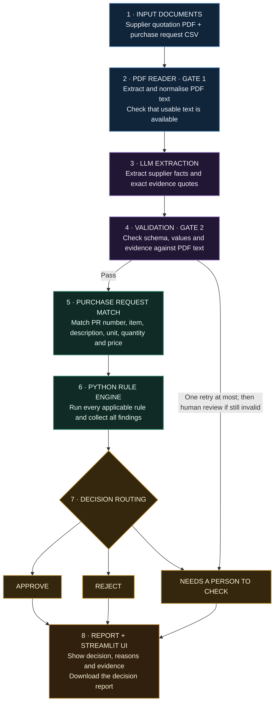

# Supplier Document Checker

An evidence-first procurement assistant that checks **one supplier quotation PDF** against a purchase request and the company's procurement rules. It extracts the facts, verifies supporting quotations, applies deterministic Python rules, and returns one of three decisions:

- **Approve** — no rejection or human-review finding applies.
- **Reject** — at least one rejection rule applies.
- **Needs a person to check** — information is unclear, missing, inconsistent, or requires human judgment.

Every decision includes the relevant evidence quotes from the supplier's PDF. When the system is unsure, it asks for human review instead of guessing.

> **Demo domain:** Aamar Garments Ltd and its procurement rules are fictional. See [samples/company-rules.md](samples/company-rules.md).

> **Project status:** All features, F001–F017, are complete (see `feature_list.json`), including the Loom demo video.

---

## How it works

The application follows a **fixed, auditable workflow**. LangGraph connects the steps; it does not make the workflow autonomous. The LLM is used only to extract structured facts and exact supporting quotes. Python validates, compares, calculates, applies the rules, and creates the final decision.



### Workflow safeguards

- **Python decides.** The LLM does not calculate prices, interpret policy, choose the decision, or write the report explanation.
- **Evidence is required.** Every non-null extracted field must include an exact quote found in the normalised PDF text.
- **One retry maximum.** If Gate 2 fails, extraction is retried once with the specific validation failures. A second failure goes to human review.
- **All rules run.** The rule engine collects every applicable finding rather than stopping at the first one.
- **Safe uncertainty.** Missing or unclear information is not silently filled in. The system routes uncertain cases to a person.
- **Untrusted document text.** Instructions embedded in supplier PDFs are treated as data, not instructions.
- **Deterministic reports.** Report text is generated from templates and verified values, not by the LLM.
- **Decimal arithmetic.** Money, percentages and thresholds use Python's `Decimal`, not floating-point arithmetic.

---

## Procurement rules

The sample policy belongs to the fictional **Aamar Garments Ltd**.

| Outcome | Rule | Condition |
|---|---|---|
| Reject | R1 | Unit price is more than 3% above the purchase-request maximum |
| Reject | R2 | Advance payment is more than 20% |
| Reject | R3 | No late-delivery penalty clause |
| Reject | R4 | Supplier TIN or BIN is missing |
| Reject | R5 | Delivery is later than 45 days after the purchase order |
| Human review | H1 | Unit price is above the maximum, but by no more than 3% |
| Human review | H2 | Quoted quantity differs from requested quantity by more than 5% |
| Human review | H3 | Payment terms are unclear, or the balance is not due within 30–60 days |
| Human review | H4 | Delivery is promised in 31–45 days |
| Human review | H5 | VAT is not shown separately at 15% |
| Human review | H6 | Quotation calculations do not add up |
| Human review | H7 | Quotation validity is less than 30 days |

The additional findings N1, N2 and M are documented in [NOTE.md](NOTE.md) and the implementation. The late-delivery penalty must be at least 0.5% of order value per week of delay. If you are unsure how a rule applies, the system should request human review.

The thresholds are centralised in `src/config.py`; the rules are implemented as small Python functions in `src/rules.py`.

---

## Technology

| Technology | Role |
|---|---|
| Python 3.12 | Application and business logic |
| Streamlit | Web interface |
| LangGraph | Connects the fixed workflow steps |
| PyMuPDF | Reads and extracts text from PDFs |
| Pydantic | Structures and validates extracted data |
| LLM provider SDKs | Extract facts and evidence from document text |
| pytest | Automated tests and evaluation harnesses |

The LLM layer supports Anthropic, OpenAI, Gemini, OpenAI-compatible endpoints, and a mock provider for tests. OpenRouter has been used for the recorded live evaluations.

---

## Getting started

### Requirements

- Python **3.12**
- Windows is the development and test environment used for this project.
- An API key for the LLM provider you choose.

### 1. Create and activate a virtual environment

**PowerShell:**

```powershell
python -m venv .venv
.venv\Scripts\Activate.ps1
python -m pip install -r requirements.txt
```

If PowerShell blocks activation, you can use the environment's Python executable directly in the commands below without activating it.

### 2. Configure the provider

```powershell
copy .env.example .env
```

Open `.env` and set the provider and model:

| Variable | Purpose |
|---|---|
| `LLM_PROVIDER` | `anthropic`, `openai`, or `gemini` |
| `LLM_MODEL` | Model name for the selected provider |
| `ANTHROPIC_API_KEY` | Anthropic API key, when using Anthropic |
| `OPENAI_API_KEY` | OpenAI or compatible-provider key |
| `GEMINI_API_KEY` | Gemini API key, when using Gemini |
| `OPENAI_BASE_URL` | Optional base URL for an OpenAI-compatible endpoint |
| `LLM_TIMEOUT_SECONDS` | Optional request timeout; defaults to 60 seconds |

The `mock` provider is intended for tests, not normal app use. **Never commit your `.env` file or API keys.**

### 3. Start the application

```powershell
python -m streamlit run app.py
```

Open the local URL printed by Streamlit. Upload a supplier quotation PDF and the purchase-request CSV, then select **Check quotation**.

The page displays the decision, reasons and supporting evidence, purchase-request match information, and model-call count. A plain-text decision report can be downloaded.

**Upload limits:** supplier PDF up to 10 MB; purchase-request CSV up to 1 MB. The 10 MB limit is also set in `.streamlit/config.toml`.

### Try it with the sample files

The `samples/` folder has everything needed for a first run:

1. Start the app (command above).
2. Upload one of `samples/supplier-pack-01.pdf` … `supplier-pack-10.pdf` as the quotation.
3. Upload `samples/purchase-request.csv` as the purchase request.
4. Select **Check quotation**.

The expected decision for each sample pack is recorded in `expected.json`.

### Purchase-request CSV format

The CSV lists the items being requested. The sample file `samples/purchase-request.csv` uses these columns:

| Column | Meaning |
|---|---|
| `PR number` | Purchase-request number, for example `PR-2026-114` |
| `Item` | Item letter within the request (`A`, `B`, …) |
| `Description` | Item description, matched against the quotation |
| `Unit` | Unit of measure, for example `metre`, `piece`, `cone` |
| `Quantity requested` | Quantity the company asked for |
| `Maximum unit price (BDT)` | Highest unit price the company will accept (used by R1 and H1) |

One CSV can contain several items. The quotation is matched to a single row by PR number, item, description and unit (see *Known limitations*, item 5).

### Using it without the UI

`check_supplier(pdf_path, csv_path)` in `src/result.py` is the single entry point that the app uses. It returns one `CheckResult`:

```python
from src.result import check_supplier

result = check_supplier("samples/supplier-pack-01.pdf", "samples/purchase-request.csv")
print(result.status, result.decision)
```

`status` is `completed`, `needs_review` or `error`. For an error, `decision` is `None` and `result.error` holds the code, a fixed message, the stage and whether a retry may help. The call uses the provider configured in `.env`.

### Errors versus decisions

Problems with the *document* are handled as a decision: an unreadable or too-short PDF, or extraction that fails validation twice, gives **Needs a person to check**. Problems with the *system or inputs* are errors, with no decision. The app shows the error code, the stage and a retry hint.

| Error code | Meaning | Retry may help |
|---|---|---|
| `INPUT_NOT_FOUND` | The supplier PDF path does not exist. | No |
| `INPUT_INVALID` | The PDF path is empty or is not a single file (for example, a folder). | No |
| `INPUT_UNREADABLE` | The PDF exists but cannot be read (permissions). | No |
| `PURCHASE_REQUEST_UNUSABLE` | The purchase-request CSV is missing, unreadable or invalid. | No |
| `LLM_ERROR` | The model could not be reached or did not answer in time. | Yes |
| `UNEXPECTED` | An unexpected problem stopped the check. | No |

The CSV is checked before any model call, so a broken CSV never uses the model.

---

## Privacy and data handling

- The text extracted from the supplier PDF is sent to the LLM provider you configure in `.env`. Check that provider's data terms before uploading real or confidential supplier documents.
- The default test suite uses the mock provider and fixtures, so it sends nothing to any provider.
- `.env` and `reports/decisions/` are git-ignored. Keep API keys out of commits, screenshots and logs.
- The sample company, suppliers and documents are fictional.

---

## Troubleshooting

| Symptom | What to do |
|---|---|
| `... is not set (see .env.example)` | Copy `.env.example` to `.env` and set the API key for your provider. |
| `LLM_PROVIDER must be one of ...` | Set `LLM_PROVIDER` to `anthropic`, `openai` or `gemini`. |
| `LLM_MODEL is not set` | Set `LLM_MODEL` to a model name your provider offers. |
| Request times out | Increase `LLM_TIMEOUT_SECONDS` (default 60). |
| Model error (rate limit, authentication, network) | The app reports it as an error, not a decision. Trying again may work once the provider problem is fixed. |
| PDF reported as unreadable | Gate 1 stops PDFs with fewer than 100 characters of extractable text, such as scans, before any model call. A person must check the document. |
| PowerShell blocks `Activate.ps1` | Skip activation and run `.venv\Scripts\python.exe -m ...` directly. |

---

## Run the tests

Run the default offline test suite:

```powershell
python -m pytest -q
```

The default suite uses the mock provider and fixtures. It does not call a live model and does not require an API key.

### Live evaluations (opt-in)

The live evaluations call the configured model and are skipped by default. Run them only when your provider configuration is ready.

```powershell
$env:RUN_LIVE_EVALUATION="1"
python -m pytest -m live -q -s
```

The F011 command evaluates the ten sample packs.

```powershell
$env:RUN_LIVE_F015="1"
python -m pytest -m live -q -s
```

The F015 command evaluates the 20 synthetic cases and the repeat-run consistency checks. The recorded F015 run took about 14 minutes.

Both commands use `-m live`, so if both environment variables are set in the same PowerShell session, both evaluations run together. To run only one, clear the variable you do not want (or both, when you are finished):

```powershell
Remove-Item Env:RUN_LIVE_EVALUATION
Remove-Item Env:RUN_LIVE_F015
```

---

## Recorded evaluation results

The results below were recorded on **5 November 2026** using `deepseek-v4.1-flash:free` through an OpenAI-compatible endpoint with prompt version `v1`. They are evidence for the tested model, prompt and fixtures—not a guarantee of accuracy on every supplier document.

| Evaluation | Recorded result |
|---|---:|
| Ten real sample packs, first F011 run | 9/10 |
| Ten real sample packs, after the separate N2 wording fix | **10/10** |
| Synthetic variants S01–S20 | **20/20** |
| Ten packs × three repeat runs | **30/30 observations** |
| Repeat stability | **10/10 packs stable; 0 flaky** |
| Default offline test suite | **1,040 passed, 3 skipped** |

The original 9/10 run is preserved as evaluation history. The N2 fix changed only the wording check; the prompt, expected results and other rules were not changed.

Evaluation artifacts are stored in [reports/evaluation/](reports/evaluation/).

---

## Known limitations

This is a controlled prototype, not yet a fully validated production procurement system.

1. **Evidence-to-field matching is limited.** Gate 2 checks that a quote appears in the PDF and that the extracted value appears in its evidence (with documented exceptions). It does not fully prove that the quote refers to the correct field; for example, a bare number can pass.
2. **Evaluation coverage is narrow.** The recorded live results use one model, one frozen prompt version and the current ten sample packs. They do not establish general accuracy across suppliers, industries or document styles.
3. **Synthetic documents are controlled.** The synthetic PDFs use a fixed text template. They test defined wording variations and repeatability, not arbitrary layouts, scanned pages or poor-quality documents.
4. **Scanned PDFs may not work.** The current PDF reader extracts embedded text; it does not provide a complete OCR pipeline for image-only scans. Gate 1 treats a PDF with fewer than 100 characters of extractable text as unreadable and sends it to a person.
5. **Purchase-request matching is intentionally strict.** PR number, item letter, description and unit must match after case and whitespace normalisation. There is no fuzzy matching; uncertain matches go to a person.
6. **Some UI checks remain open.** Manual verification of rejection for a PDF larger than 10 MB and visual confirmation of the 240-character text truncation are still recommended.

Do not use the current evaluation scores alone as the basis for unattended purchasing or supplier rejection. Human review and broader real-world validation are necessary before production use.

---

## Project structure

```text
supplier-document-checker/
├── app.py                     # Streamlit interface
├── src/
│   ├── graph.py               # Fixed LangGraph workflow
│   ├── pdf_reader.py          # PDF text extraction and Gate 1
│   ├── extractor.py           # LLM extraction prompt and call
│   ├── llm.py                 # Multi-provider LLM layer
│   ├── schema.py               # Structured extraction schema
│   ├── validators.py          # Gate 2 schema/evidence checks
│   ├── parsing.py              # Safe parsing helpers
│   ├── compare.py              # Purchase-request matching
│   ├── rules.py                # Procurement rules
│   ├── config.py               # Centralised thresholds
│   ├── result.py               # Immutable result structures
│   ├── report.py               # Deterministic decision reports
│   ├── ui_helpers.py           # Upload checks and result views used by app.py
│   ├── evaluation.py           # Golden evaluation harness
│   ├── synthetic.py            # Synthetic test cases and PDFs
│   └── consistency.py          # Repeat-run consistency checks
├── samples/                    # Example PDFs, CSV and company rules
├── tests/                      # Offline and opt-in live tests, with gold and synthetic fixtures
├── reports/
│   ├── supplier-pack-NN.txt    # Raw extracted PDF text for the sample packs
│   ├── decisions/              # Generated supplier decision reports
│   └── evaluation/             # Recorded evaluation evidence
├── expected.json               # Expected decisions for sample packs
├── feature_list.json           # Feature status tracker
├── pytest.ini                  # Test configuration and the live-test marker
├── .env.example                # Provider settings template (copy to .env)
├── .gitignore                  # Keeps .env and generated decision reports out of git
├── .streamlit/config.toml      # Streamlit settings (10 MB upload limit)
├── requirements.txt
├── NOTE.md                     # Detailed technical notes and design decisions
├── AGENTS.md                   # Development constraints and project rules
├── progress.md                 # Development progress
└── AI-LOG.md                   # AI development mistakes and corrections
```

---

## License

No license file has been added to this repository yet. Until the owner chooses and adds one, no permission to reuse the code is granted.

---

## Design principle

**The model extracts. The code verifies. The rules decide. A person handles uncertainty.**

This separation is the core safety property of the Supplier Document Checker.
